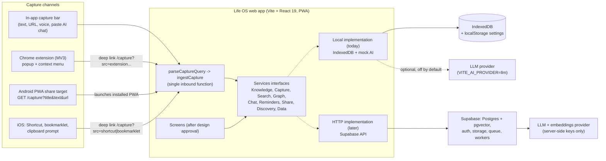
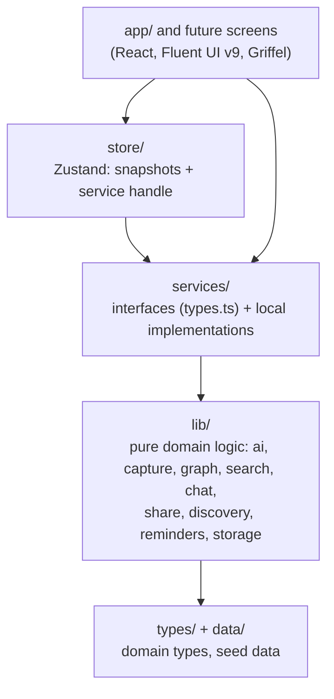
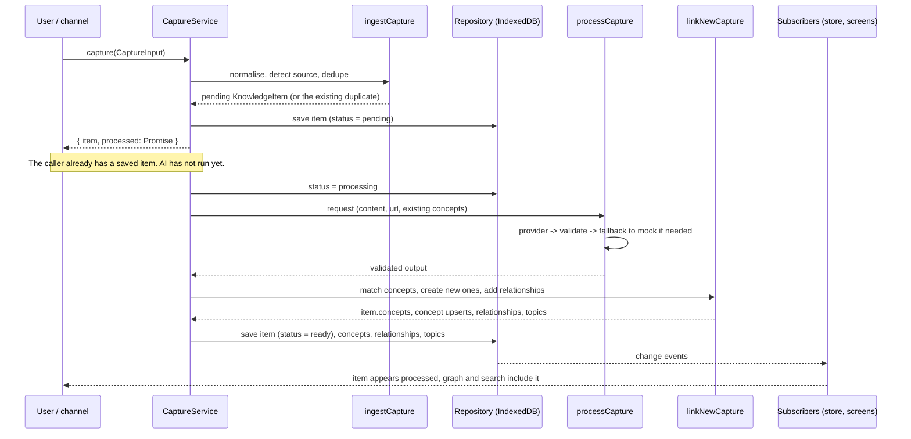
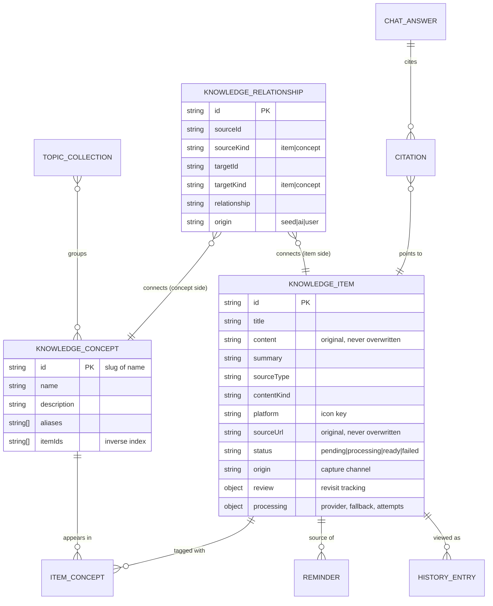
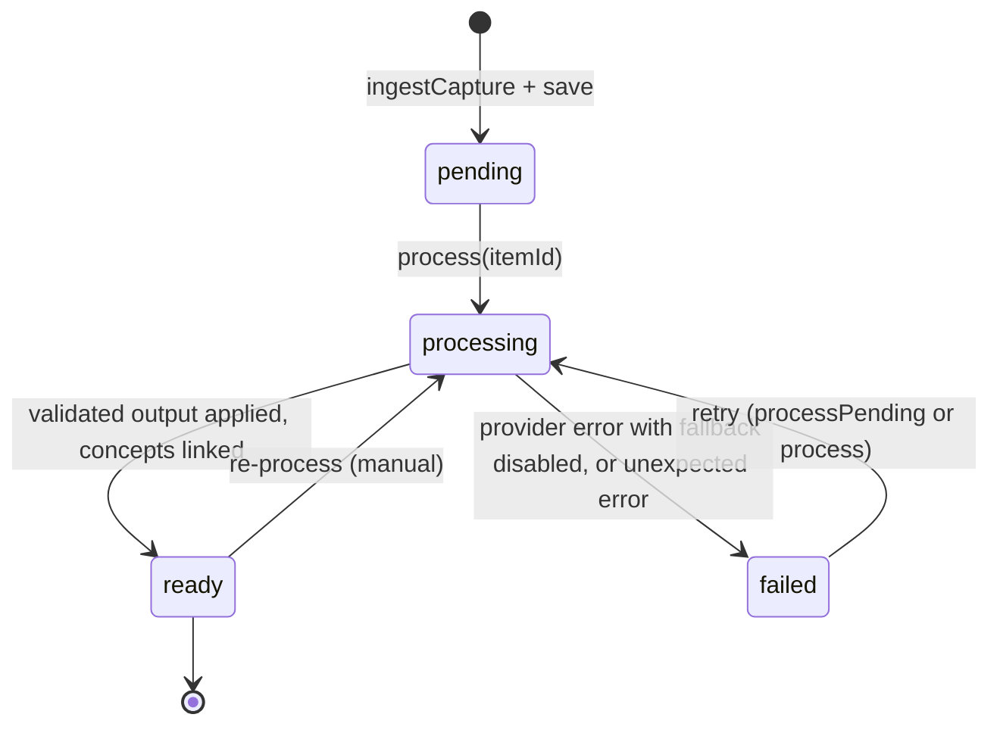
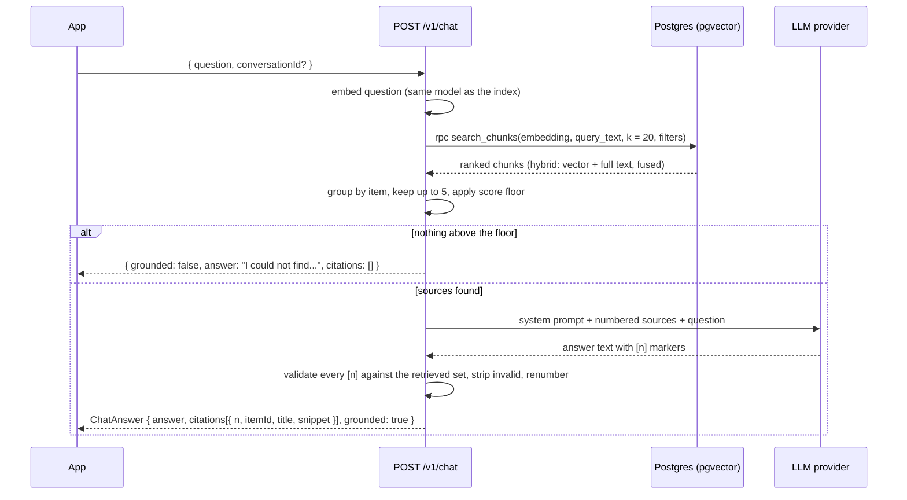
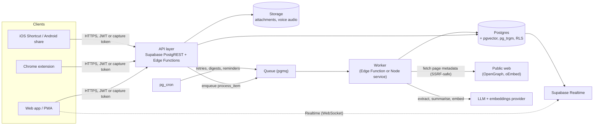

# Life OS: Architecture

**Status:** Phase 1 (engineering track). Written alongside the scaffold, the headless domain layer, the capture channels and their tests.
**Owner:** Track B (Engineering). **Reads with:** `LifeOS-Hackathon-Idea.md` (the product brief) and `LifeOS-Build-Plan.md` (scope changes and stack decision, which override the brief where they differ).

This document does four jobs. It describes what is built today (a local-first app with a mock service layer), defines the contracts the screens will call, records the decisions behind them, and specifies how the real backend will be built so that moving from mock to real means replacing implementations, not rewriting screens.

Everything stated as "verified" was checked either by the test suite in this repository or against a cited platform source on the date of writing (22 November 2026). Everything stated as "not yet verified on a device" is called out explicitly.

---

## 1. System overview

### 1.1 What Life OS does

Life OS is a personal knowledge app. A user captures anything (a thought, a link, a voice note, a pasted AI conversation) from wherever they are. The app structures the item with AI-style processing, connects it to what the user already knows in a knowledge graph, and brings it back through swipeable cards, search, and a chat that answers in consolidated prose with citations to the user's own saved items.

The product is used mainly on a phone in the browser, installable as a PWA, with a richer desktop web layout. It is one responsive codebase.

### 1.2 Principles that shape the architecture

1. **One inbound function.** Every capture channel produces a `CaptureInput` and calls `ingestCapture`. Processing, storage and the inbox are identical regardless of origin.
2. **Save first, enrich second.** Saving never waits on AI. An item exists, with its original content and URL intact, before processing starts. Processing can fail and the item is still safe.
3. **AI proposes, validation disposes.** Every provider (mock, LLM, backend) returns untrusted data. The app validates it against a schema, falls back to the deterministic mock, and pins facts that are not the model's to change (URL, source, capture time, original text).
4. **Everything behind an interface.** Screens call `Services` (async interfaces). The local implementation is replaced by an HTTP implementation later. No screen imports a database, a model client or `fetch`.
5. **Answers are constrained by retrieval.** Chat answers are built only from retrieved items, every citation is validated against the retrieved set, and "I could not find that" is a first-class answer.
6. **Local-first.** The app works offline with IndexedDB today. In production the local store becomes a cache and an outbox in front of the backend.

### 1.3 Context diagram



### 1.4 Layering



The rule is one-directional: `lib/` has no knowledge of React, the store or services. It is plain functions over plain data, which is why the unit tests are fast and why the same logic can later run in a backend worker (see section 10.5).

### 1.5 Capture-to-retrieval sequence



---

## 2. Module map

The project root is the application. `src/` is organised so that the approved design can be built on top without touching domain code.

```
LifeOS/
  index.html                    Entry; PWA meta, theme-color, apple-touch-icon
  vite.config.ts                Vite + React + vite-plugin-pwa (manifest incl. share_target) + Vitest config
  public/                       favicon.svg, icons/ (192, 512, maskable, apple-touch-icon)
  scripts/generate-icons.mjs    Dependency-free PNG icon generator (app + extension)
  extension/                    Chrome extension (MV3, plain JS, no build step) + README
  .env.example                  Optional LLM configuration (never real keys)
  src/
    main.tsx                    React root
    app/                        Shell only until the design is approved
      App.tsx                   FluentProvider (theme), router, placeholder pages
      CaptureRoute.tsx          Functional /capture deep-link entry (unstyled)
      routes.ts                 Route table (Home, Explore, Capture, Graph, Library, Ask, Item)
    theme/index.ts              Violet/indigo brand ramp; light, dark, high-contrast themes; resolveThemeName
    types/knowledge.ts          Domain types (section 4)
    data/demo-knowledge.ts      14 items, 20 concepts, 29 relationships, 5 topics, 3 reminders, history
    lib/                        Pure domain logic, no React
      ids.ts                    slugify, id generators (random and sequential for tests), uniqueStrings
      ai/                       schema (zod), types (AIProvider), mock-processor, lexicon, demo-urls,
                                processor (processCapture, apply/fail helpers), prompts, llm-provider
      capture/                  url-detector, inbound (ingestCapture, parse/build deep link),
                                clipboard, bookmarklet, voice
      graph/                    graph-builder (buildGraph, layoutGraph, linkNewCapture, getNeighborhood),
                                concepts (matching, inverse index), related, react-flow adapter
      search/search.ts          BM25-style ranked search, filters, sort, suggestions
      chat/answer.ts            askKnowledge: retrieval, composition, citation validation
      share/share.ts            Web Share API with clipboard fallback; payload builders
      discovery.ts              Today's Discovery, Explore deck order, revisit tracking, progress, history
      reminders.ts              Due-date phrase parsing, suggestions from actions
      storage/                  Repository port, IndexedDB + memory adapters, migrations, seed, settings
    services/
      types.ts                  The service interfaces screens call (section 5)
      index.ts                  createDefaultServices: the one place that picks the implementation
      local/                    LocalStore (cache + write-through) and the local service implementations
    store/lifeos-store.ts       Zustand store: snapshots, processing ids, capture(), service handle
    test/setup.ts               jest-dom matchers + fake-indexeddb
```

Ownership follows the build plan: Track B owns everything above except screens, which Track A's approved design will define and Track B will build in phase 3.

### 2.1 Technology choices and versions

| Concern | Choice | Notes |
|---|---|---|
| Build | Vite 8, TypeScript 7 (`strict`), React 19 | Plain SPA; nothing needs server rendering |
| UI | Fluent UI v9 (`@fluentui/react-components` 9.75), Griffel `makeStyles`, `@fluentui/react-icons` | Per the designer defaults; no Tailwind, shadcn or Lucide |
| Graph | `@xyflow/react` 12.12 (React Flow) | Pinned to 12.x. The npm `latest` tag currently points at a 13 pre-release, which we deliberately avoided |
| Motion | Framer Motion 14 | For card swipe in phase 3 |
| Routing | `react-router-dom` 7 | |
| State | Zustand 5 | Snapshots only; services own behaviour |
| Persistence | `idb` over IndexedDB; `localStorage` for small settings | Section 9 |
| Validation | `zod` 4 | Processing output schema |
| PWA | `vite-plugin-pwa` 2 (Workbox `generateSW`) | Section 11 |
| Tests | Vitest 5, Testing Library, jsdom, `fake-indexeddb` | Section 12 |

`package.json` declares `engines.node >= 20.19` and `.nvmrc` pins Node 22.

---

## 3. Platform channels at a glance

| Channel | Platform | Needs a backend? | Where it lands in code |
|---|---|---|---|
| Quick capture bar (text, URL, paste AI chat) | All | No | `CaptureService.capture` |
| Voice | Chromium, Safari with SpeechRecognition; mock fallback elsewhere | No | `lib/capture/voice.ts` |
| Chrome extension | Desktop Chromium | No (deep link to the app) | `extension/`, `/capture` route |
| PWA share target | Android Chrome, Samsung Internet; Chrome desktop when installed | No | Manifest `share_target`, `/capture` route |
| iOS Shortcut | iPhone, iPad | No for the deep-link variant; yes for the direct-post variant | Section 8.5 |
| Bookmarklet | Any browser, including iOS Safari | No | `lib/capture/bookmarklet.ts` |
| Clipboard prompt | All (iOS needs a tap and a system confirmation) | No | `lib/capture/clipboard.ts` |

Section 8 explains each in detail, including the iOS limitations.

---

## 4. Domain model

The model starts from section 9 of the brief and extends it. All types live in `src/types/knowledge.ts`. Timestamps are ISO-8601 UTC strings. Ids are opaque strings, with one deliberate exception: concept ids are deterministic slugs of the concept name, so the same concept created on two devices merges instead of duplicating.

### 4.1 Entity diagram



### 4.2 Changes from the brief (section 9) and why

| Entity | Brief | Now | Reason |
|---|---|---|---|
| `KnowledgeItem.sourceType` | text, voice, instagram, youtube, website, journal, chat | adds `podcast` | The brief's capture list includes podcasts |
| `KnowledgeItem.contentKind` | not present | note, idea, video, reel, article, podcast, voice_note, journal, conversation, link | Content type is independent of where it came from. Powers the Library filters (Articles, Videos, Voice notes, Journal, Ideas) |
| `KnowledgeItem.platform` | not present | icon key (youtube, instagram, tiktok, x, linkedin, reddit, github, medium, substack, spotify, apple-podcasts, podcast, website, text, voice, journal, chat) | The brief asks the app to "show its platform icon" |
| `KnowledgeItem.concepts` | concept names | concept ids (slugs) | Joins are exact; renaming a concept does not orphan items. `KnowledgeConcept.itemIds` is the inverse index, recomputed from items |
| `KnowledgeItem.isProcessed` | boolean | `status`: pending, processing, ready, failed, plus `processing` info | A boolean cannot represent "in progress" or "failed, retry me" |
| `KnowledgeItem.origin` | not present | in-app, voice, extension, share-target, bookmarklet, shortcut, clipboard, import, seed | The unified inbox shows where each item came from, and the product can measure channels |
| `KnowledgeItem.review` | not present | `viewCount`, `firstViewedAt`, `lastViewedAt`, `nextReviewAt` | The build plan requires tracking what the user has revisited |
| `KnowledgeItem.actions` | not present | string list | The processing output has `actions`; they seed reminders |
| `KnowledgeConcept.aliases` | not present | string list | "MCP" and "Model Context Protocol" must resolve to one concept |
| `KnowledgeRelationship` | `sourceId`, `targetId`, 4 types | adds `sourceKind`/`targetKind` (item or concept), types `contradicts` and `derived_from`, and `origin` (seed, ai, user) | The graph links concepts to concepts and items to items; the brief's prose lists six relationship types; origin lets the UI mark AI suggestions as editable |
| `Reminder` | id, title, description, dueAt, completed, sourceItemId | adds `createdAt`, `completedAt`, `confirmed` | The brief says the user "can confirm or edit" an AI-suggested reminder, which needs an unconfirmed state |
| `JournalEntry` | `KnowledgeItem` with `sourceType: "journal"` | unchanged | Per the brief: no separate storage |
| New: `TopicCollection` | not present | id, name, description, `conceptIds`, icon | Topic collections and the graph's topic nodes |
| New: `Citation`, `ChatAnswer` | not present | Section 7 | Chat with citations |
| New: `CaptureInput` | not present | origin, kind, text, url, title, note, capturedAt | The single inbound shape |
| New: `HistoryEntry`, `ExploreProgress` | not present | Item opened at a time, via a surface; counts and fractions | Visible history and progress |
| New: `DailyDiscovery` | not present | date, past insight, connected concept, revisit item, each with a reason | Today's Discovery |

### 4.3 Invariants

- `content`, `sourceUrl`, `createdAt` and `origin` are written once, at capture, and never changed by processing (`applyProcessingResult` copies the item and sets only enrichment fields; tests assert this).
- `status` moves `pending -> processing -> ready` or `failed`. `failed` and `pending` items are retried by `processPending()`.
- `KnowledgeConcept.itemIds` always equals the set of items whose `concepts` include the concept (`reconcileConceptItemIds`, asserted on the seed data and re-synced after every capture or edit).
- Concept ids are `slugify(canonicalName)`. Matching is by name, alias and a plural-insensitive key (`AI Agent` matches `AI Agents`).
- A duplicate capture (same normalised URL, or identical text with no URL) returns the existing item and creates nothing.

### 4.4 Item lifecycle



With the default configuration the mock fallback means an item reaches `ready` even when the LLM provider fails; `failed` is reachable only when fallback is explicitly disabled or storage itself fails.

---

## 5. Service interfaces

Screens call only these interfaces (`src/services/types.ts`). All methods are async. `createDefaultServices()` in `src/services/index.ts` chooses the implementation. The Zustand store (`src/store/lifeos-store.ts`) holds the service handle plus snapshots (items, concepts, collections, reminders, in-flight processing ids) that refresh on change events.

```ts
interface Services {
  knowledge: KnowledgeService; capture: CaptureService; search: SearchService;
  graph: GraphService; chat: ChatService; reminders: ReminderService;
  share: ShareService; discovery: DiscoveryService; data: DataService;
}

interface KnowledgeService {
  listItems(query?: { filters?: SearchFilters; sort?: SortMode; limit?: number }): Promise<KnowledgeItem[]>;
  getItem(id: string): Promise<KnowledgeItem | undefined>;
  getItemDetail(id: string): Promise<ItemDetail | undefined>;   // item, concepts, relatedItems (with reasons), topics, reminders
  updateItem(id: string, patch: ItemPatch): Promise<KnowledgeItem>; // title, summary, content, tags, keyTakeaways, actions, isFavorite, conceptNames
  toggleFavorite(id: string): Promise<KnowledgeItem>;
  deleteItem(id: string): Promise<void>;
  listConcepts(): Promise<KnowledgeConcept[]>;
  getConceptDetail(id: string): Promise<ConceptDetail | undefined>; // concept, items, relatedConcepts, topics
  listCollections(): Promise<CollectionSummary[]>;                  // topic, itemCount, concepts, recentItems
  getCollection(id: string): Promise<CollectionSummary | undefined>;
  subscribe(listener: (event: ChangeEvent) => void): Unsubscribe;
}

interface CaptureService {
  capture(input: CaptureInput, options?: { process?: boolean }): Promise<CaptureResult>; // { item, duplicate, processed?, reminder? }
  captureFromQuery(search: string, options?: { process?: boolean }): Promise<CaptureResult | null>;
  process(itemId: string): Promise<KnowledgeItem>;
  processPending(): Promise<KnowledgeItem[]>;
}

interface SearchService {
  search(query: string, options?: { filters?: SearchFilters; sort?: SortMode; limit?: number }): Promise<SearchResult[]>;
  suggest(prefix: string, limit?: number): Promise<string[]>;
}

interface GraphService {
  getGraph(options?: GraphOptions): Promise<GraphData>;            // nodes (concept|item|journal|topic), edges, layout positions
  getNeighborhood(nodeId: string, depth?: number): Promise<GraphData>;
}

interface ChatService {
  ask(question: string): Promise<ChatAnswer>;                       // answer text with [n] markers, citations, grounded flag, follow-ups
  getHistory(limit?: number): Promise<ChatAnswer[]>;
  clearHistory(): Promise<void>;
}

interface ReminderService {
  list(filter?: { completed?: boolean; sourceItemId?: string; confirmed?: boolean }): Promise<Reminder[]>;
  create(input: { title: string; description?: string; dueAt?: string; sourceItemId?: string }): Promise<Reminder>;
  update(id: string, patch: Partial<Pick<Reminder, "title" | "description" | "dueAt">>): Promise<Reminder>;
  confirm(id: string, patch?: Partial<Pick<Reminder, "title" | "description" | "dueAt">>): Promise<Reminder>;
  setCompleted(id: string, completed: boolean): Promise<Reminder>;
  remove(id: string): Promise<void>;
  suggestFromItem(itemId: string): Promise<ReminderSuggestion[]>;
}

interface ShareService {
  canShareNatively(): boolean;
  buildPayload(request: ShareRequest): Promise<SharePayload>;
  share(request: ShareRequest): Promise<ShareResult>;               // native sheet, else clipboard
}
// ShareRequest = { kind: "item" | "card" | "summary" | "source-link"; itemId } | { kind: "collection"; topicId }

interface DiscoveryService {
  getDailyDiscovery(): Promise<DailyDiscovery>;                     // stable for the calendar day
  getExploreDeck(mode?: "for-you" | "new" | "due" | "favorites" | "all"): Promise<KnowledgeItem[]>;
  recordView(itemId: string, via: ViewSurface): Promise<ReviewState>;
  getHistory(limit?: number): Promise<{ entry: HistoryEntry; item: KnowledgeItem }[]>;
  getProgress(): Promise<ExploreProgress>;                          // total, seen, unseen, revisited, due, seenFraction
}

interface DataService {
  exportAll(): Promise<ExportBundle>;
  resetToDemo(): Promise<void>;
}
```

Two behaviours worth knowing before building screens:

- `capture()` resolves as soon as the item is saved. `result.processed` is a promise for the processed item and never rejects. The UI can show the "AI is organising this" state from `item.status` (or the store's `processingIds`) and swap to the structured result when `processed` resolves or a change event arrives.
- Reads are cheap and consistent because the local store keeps an in-memory working set that is written through to IndexedDB. A backend implementation will use the same method shapes with a cache in front.

---

## 6. AI processing pipeline

### 6.1 Stages

The pipeline implements section 11 of the brief: **Capture, detect source, extract, summarise, concepts, tags, relationships, save**.

| Stage | Where | What happens |
|---|---|---|
| 1. Capture | `ingestCapture` | Normalise input, detect URL and platform, classify, dedupe, create a `pending` item. Pure and synchronous |
| 2. Detect source | `detectUrl`, `buildProcessRequest` | Platform key, source type, content kind, source name. No network |
| 3. Extract | `buildProcessRequest` | Collect what is available without scraping: the user's text, note, selection, title, URL slug. For a bare link the request has no body, and the pipeline says so |
| 4. Summarise, concepts, tags, takeaways, actions | `AIProvider.process` | Mock (default) or LLM, returning untrusted JSON |
| 5. Validate | `parseProcessingOutput` (zod) | Tolerates code fences and prose around JSON, normalises tags (strips `#`, dedupes, caps lengths), maps an unknown `content_type` to the nearest valid one, rejects missing title, summary or concepts |
| 6. Fallback | `processCapture` | On error, timeout (default 20 s) or invalid output, the deterministic mock runs. Records `usedFallback` and the error on the item |
| 7. Pin originals | `pinOriginals` | The original URL and source always win over whatever the model returned |
| 8. Relationships | `linkNewCapture` | Match concept names to existing concepts (name, alias, plural-insensitive), create new ones, update inverse indexes, connect the item's concepts, link related topics, place new concepts into the best-overlapping topic |
| 9. Save | `CaptureService` | Persist item, concepts, relationships and topics; recompute the concept inverse index; emit change events |

### 6.2 Output contract

The brief's example output is the schema (snake_case, matching the future API):

```json
{
  "title": "Understanding AI Agents",
  "content_type": "video",
  "source": "youtube",
  "url": "https://youtube.com/example",
  "summary": "An introduction to autonomous AI agents.",
  "key_takeaways": ["Agents can plan and execute tasks", "Tools extend agent capabilities"],
  "concepts": ["AI Agents", "Tool Calling"],
  "tags": ["AI", "Automation"],
  "actions": ["Explore agent frameworks"],
  "related_topics": ["MCP", "AI Workflows"]
}
```

Rules enforced by `processingOutputSchema`: `title`, `summary`, `source` non-empty; at least one concept; takeaways capped at 6, concepts at 10, tags at 8, actions at 5, related topics at 6; summary capped at 600 characters, title at 160.

### 6.3 Providers

`AIProvider` is `{ name; process(request, signal?) => Promise<unknown> }`. It returns unknown on purpose: the processor validates, so no provider is trusted.

- **`MockAIProvider`** is deterministic and offline. For four known demo URLs (a YouTube video on agents, an Instagram reel on context engineering, a design-systems article, a Spotify podcast on SaaS) it returns curated metadata, so the demo is stable. For everything else it uses a lexicon of 20 concepts with aliases and keywords to match concepts, derive tags and related topics, extract the first sentences as summary and takeaways, and pick action sentences by cue words. It never pretends to have read a page it did not fetch: for a bare link the summary says the original link is kept.
- **`LlmAIProvider`** is a thin client for any OpenAI-compatible chat-completions endpoint, in JSON mode, using the prompts in `lib/ai/prompts.ts`. It is off unless `VITE_AI_PROVIDER=llm` and `VITE_LLM_API_KEY` are set (`.env.example` documents this). Because `VITE_` variables are bundled into client code, a browser-side key is for local demos only; production moves this call behind the backend (section 10.6).
- **Backend provider (future)** is an `AIProvider` whose `process` calls `POST /v1/items/{id}/process`, or, more likely, the server runs the same pipeline in a worker and the client only observes `status`.

### 6.4 Guarantees (all covered by tests)

- Invalid JSON, schema failures, HTTP errors, thrown errors and timeouts all fall back to the mock.
- `fallback: false` surfaces the failure; the capture service then marks the item `failed`, keeps it saved, and `processPending()` retries it.
- Processing never edits `content`, `sourceUrl`, `createdAt` or `origin`.
- Concurrent calls for one item share a single in-flight run (double taps and duplicate deep links do not process twice).
- If the user edits an item while processing runs, the latest stored item is the base, so edits are not lost.

---

## 7. Retrieval and chat with citations

### 7.1 Hackathon implementation (built)

**Ranking (`lib/search/search.ts`).** A BM25-style scorer over seven fields with weights: title 3, tags 2.5, concepts 2.5, source 1.5, summary 1.5, takeaways 1, content 1 (`k1 = 1.2`, `b = 0.75`, per-field length normalisation). Tokens are lowercased, accent-stripped, stopword-filtered and lightly stemmed. A query that names a concept or one of its aliases is expanded with the other names as **phrases** at weight 0.6, so "MCP" finds the "Model Context Protocol" item without "agents" dragging in everything about "AI". The last word also matches as a prefix at half weight, so results update as the user types. Scores are multiplied by a coverage factor (the share of the typed words matched) and a small favourite boost. Filters cover source type, content kind, tags, concepts, topic, favourites, status and date; sorts are relevance, recent, oldest, title and topic.

This builds its index on every query. That is fine for the hundreds to low thousands of items a hackathon-scale library holds; section 14 lists a cached index as the first optimisation if it grows.

**Chat (`lib/chat/answer.ts`).** `askKnowledge(question, deps)` works in this order:

1. **Retrieve.** Search `ready` items using question-word stopwords (what, show, saved, ...). Keep results with score at least 1.2 and at least 30 percent of the top score, up to five sources. Questions of the form "connections between X and Y" retrieve for each side and keep both.
2. **If nothing is retrieved, say so.** The answer states that nothing was found, cites nothing, sets `grounded: false`, and offers follow-ups drawn from the user's most-used concepts. The model is not asked to improvise.
3. **Compose.** The deterministic composer writes an opening line, one cited bullet per source using that source's own snippet, and a "How they connect" section from concepts shared by two or more sources. If an `AnswerComposer` (LLM) is configured it receives only the numbered sources; its output is accepted only if it contains at least one valid citation.
4. **Validate citations.** `validateCitations` removes any `[n]` that does not match a retrieved source, drops citations the text never uses, and renumbers the rest in order of first use. A fabricated marker cannot reach the UI.
5. **Return** a `ChatAnswer`: answer text with `[n]` markers, `citations` (`n`, `itemId`, `title`, `snippet`, `sourceUrl`), `grounded`, related concept names, follow-up questions and the provider name.

Example (seed data, mock composer), for "What did I save about AI agents?":

```
You have 5 saved items on AI agents, mostly about AI Agents, Automation and Context Engineering [1][2][3][4][5].

What they say:
- Understanding AI agents: An introduction to autonomous AI agents: a model that plans, calls tools and iterates until the goal is met. [1]
- The future of SaaS in an agent world: Agents may shift SaaS pricing from seats to outcomes ... [2]
...
How they connect:
- AI Agents appears in [1], [2], [3], [4] and [5].
- Tool Calling appears in [1] and [4].
```

For a question with no match ("what is the capital of France"): "I couldn't find anything in your saved knowledge about ... Nothing is cited because there is nothing relevant to cite."

The mock composer is intentionally extractive: it consolidates what the sources say rather than generating new claims, which is exactly the property the production system must keep.

### 7.2 Production design



- **Index.** Each item is split into chunks of roughly 300 to 500 tokens with small overlap, plus one chunk made of title and summary. Each chunk stores an embedding (`vector(1536)` by default), the embedding model name (so re-embedding is possible), and a `tsvector`. An HNSW index with cosine distance serves vector search.
- **Hybrid retrieval.** Reciprocal rank fusion of vector similarity and full-text rank, then group by item. This keeps exact-term queries ("MCP") strong while allowing conceptual ones ("how do I make AI more reliable").
- **Constrained generation.** The prompt contains only the retrieved sources, numbered. The system prompt forbids claims outside them and requires `[n]` citations. Source text is delimited and treated as data (section 10.9).
- **Citation validation is server-side and again client-side.** Both run the same `validateCitations` logic; the client check protects against a faulty server and keeps the mock and real paths identical.
- **Streaming.** The endpoint can stream tokens over Server-Sent Events and send the validated citation list in a final event. The UI shows text as it arrives and activates citation chips when the list arrives.
- **Quotas and cost.** Per-user daily limits, a token budget per answer, a cache keyed by (question, retrieved item ids, item versions).

The local `askKnowledge` is the executable specification for this endpoint: same retrieval-then-compose order, same not-found behaviour, same validation.

---

## 8. Capture channels

### 8.1 The deep-link contract

Every non-in-app channel is a navigation to the app's `/capture` route with a query string:

```
/capture?url=<url>&title=<title>&text=<text>&note=<note>&kind=<kind>&src=<origin>
```

| Param | Meaning |
|---|---|
| `url` | The page or link being saved |
| `title` | Page title or share title |
| `text` | Selected text, or whatever the sharing app put in the "text" field |
| `note` | The user's own comment (extension popup) |
| `kind` | Optional hint: `text`, `url`, `voice`, `journal`, `chat`, `reminder` |
| `src` | Origin: `extension`, `bookmarklet`, `shortcut`, `clipboard`, `in-app`, `voice`, `import`. Anything else, or nothing, is treated as `share-target`, because the OS launches a share target with only `title`, `text` and `url` |

`parseCaptureQuery` returns `null` when the query carries nothing capturable, so opening `/capture` directly shows an explanation, not an empty item. `buildCaptureDeepLink` is the inverse and supports an app served from a sub-path. `CaptureRoute` calls `captureFromQuery`, then replaces the URL with `/capture` so a refresh does not capture again.

The single inbound function `ingestCapture(input, { existingItems, now, idGenerator })` then:

- Pulls a URL out of free text when `url` is absent (share sheets often put the link inside `text`), as long as the surrounding note is under 600 characters, so a long pasted article that happens to contain a link is not misread as a link.
- Treats an explicit `journal`, `voice` or `chat` kind as free-form, so a URL mentioned in a journal entry does not turn it into a link.
- Recognises a pasted AI conversation (two or more speaker lines such as `You:` and `ChatGPT:`) and share links from ChatGPT, Gemini, Claude, Perplexity and Copilot.
- Keeps an invalid "URL" as text instead of dropping it, and rejects an empty capture with `EmptyCaptureError`.
- Normalises URLs for duplicate detection: removes tracking parameters, fragments and trailing slashes, canonicalises YouTube (`youtu.be`, `m.`, extra params) and Instagram (`/reels/` to `/reel/`, all params dropped).
- Derives a title: the explicit title, else the first sentence of the content, else a readable form of the URL slug.

Platform detection (`detectUrl`) returns the platform key for icon lookup plus source type, content kind and source name for YouTube, Instagram, TikTok, X, LinkedIn, Reddit, GitHub, Medium, Substack, Spotify (episodes and shows become podcasts), Apple Podcasts, other podcast hosts, AI chat domains, and a generic website fallback. A scheme-less string counts as a URL only when it starts with `www.` or belongs to a known platform, so ordinary sentences are not misdetected.

### 8.2 In-app capture

The primary path. The capture bar calls `capture.capture({ origin: "in-app", text | url, kind? })`. Kinds map to the brief's inputs: text, URL, voice, journal, reminder, and a dedicated "paste an AI conversation" option (`kind: "chat"`). A `reminder` capture also creates an unconfirmed-or-confirmed `Reminder` with a parsed due date ("this weekend", "tomorrow", "in 3 days", "on Friday").

**Voice** (`lib/capture/voice.ts`) wraps `SpeechRecognition` / `webkitSpeechRecognition` behind `VoiceTranscriber` (start, stop, abort; interim and final text; mapped errors such as `not-allowed` and `no-speech`). When recognition is unavailable (Firefox, insecure origin, blocked microphone), `createTranscriber()` returns a `MockTranscriber` that yields a canned transcript on stop, with `source: "mock"` so the UI can label it as a demo. The brief also mentions `MediaRecorder` as a fallback for capturing audio; that is not built, because without a transcription backend the recording would have nothing to feed. It is a phase-3 or backend item. Note that Chrome's recognition sends audio to a remote service, which the voice UI should disclose.

### 8.3 Chrome extension (desktop)

Built in `extension/` (Manifest V3, plain JavaScript, no build step; see `extension/README.md`). A toolbar popup shows the current page, any selected text and an optional note, and one button, **Save to Life OS**. Three context-menu entries cover selected text, links and pages. A keyboard shortcut (`Cmd/Ctrl+Shift+L`) opens the popup. The app URL is configurable (default `http://localhost:5173`).

It requests only `activeTab`, `scripting`, `contextMenus` and `storage`: no host permissions, no content scripts. The selection is read with `chrome.scripting.executeScript` only after the user clicks. The hand-off builds the deep link above and opens it in a small popup window (or a tab); the app does the rest. `extension/capture-link.js` is imported directly by `src/lib/capture/inbound.test.ts`, which round-trips its links through `parseCaptureQuery` and `ingestCapture`, so the two sides cannot drift apart silently.

Because the app opens on its own origin, it reads and writes the same IndexedDB the user's normal Life OS tab uses (same browser profile, same origin).

### 8.4 Android: PWA Web Share Target

`vite.config.ts` writes this into the web manifest (verified in the production build output):

```json
"share_target": { "action": "/capture", "method": "GET",
                  "params": { "title": "title", "text": "text", "url": "url" } }
```

**Platform support (verified 22 November 2026).** Chrome for Android 76 and later, Samsung Internet 12 and later, and Chrome on desktop 89 and later (installed PWAs) support `share_target`. Firefox does not. WebView does not. Safari on iOS and macOS does not (see 8.5).

**Flow.**

1. The user installs Life OS to the home screen from Chrome (install prompt or menu).
2. In any app, the user taps Share. Life OS appears in the share sheet.
3. Android launches the installed PWA at `/capture?title=...&text=...&url=...`.
4. `CaptureRoute` parses the query, `ingestCapture` creates a pending item with origin `share-target`, processing runs, the user sees the confirmation.

**Practical notes.**

- The PWA must be installed, and the app must be served over HTTPS (or `localhost`). A phone on the same Wi-Fi opening `http://192.168.x.x:5173` cannot install the PWA or use the share target. Testing on a device needs a deployed or tunnelled HTTPS URL.
- Which field carries the link depends on the sharing app. Many apps put the URL inside `text` and leave `url` empty, others fill `url`. `ingestCapture` handles both (it extracts a URL from `text`), which is why that behaviour exists and is tested.
- The `GET` variant is enough for URLs and text. Sharing images or files would need `POST` with `multipart/form-data` and a service-worker handler; that is out of scope for now.
- The action `/capture` is inside the manifest `scope` (`/`). The hosting must serve `index.html` for unknown paths so that a cold start at `/capture?...` loads the SPA; the service worker's `navigateFallback` does this offline.
- Not yet verified on a physical Android device in this phase. The manifest output and the parsing logic are verified by build and tests.

### 8.5 iOS path (and the share-target limitation, verified)

**The limitation.** iOS and iPadOS Safari do not implement the Web App Manifest `share_target` member: Life OS will not appear in the iOS share sheet as a destination. The WebKit tracking bug is `webkit.org/b/194593`, and compatibility data from OpenPWA (checked 20 October 2026) and MDN list Safari on iOS and macOS as "No". What iOS does support is the Web Share API for sending content out (`navigator.share`, Safari 12.2 and later), which Life OS uses for sharing cards. So on iOS, Life OS can share out but cannot receive from the system share sheet.

**A second, larger iOS constraint (verified).** A site added to the Home Screen as a web app keeps its website data (IndexedDB, localStorage, caches, service workers) **isolated from Safari**, even for the same origin (WebKit documents this; OpenPWA and progressivewebapps.com summarise it, September and October 2026). Consequences for a no-backend build:

- A bookmarklet or Shortcut that opens the app's deep link opens it in **Safari**, not in the installed Home Screen web app. The item is then saved into Safari's storage, and it will not appear in the installed web app's library.
- Without a backend, the only consistent iOS experience is to use Life OS in Safari without installing it, so that the deep links and the app share one storage.
- With the backend (section 10), this disappears: every channel posts to the user's account, and both the Safari tab and the installed app read the same data.

This is the strongest reason the real backend, and the direct-post capture endpoint with a scoped capture token (10.4), are on the roadmap even though the hackathon build does not need them.

**Supported iOS options and their status**

| Option | Works without a backend | Notes |
|---|---|---|
| Shortcut that opens the deep link | Yes, but saves into Safari storage (see above) | Appears in the share sheet; one tap |
| Shortcut that posts to the capture API with a token | No | The right production path; works regardless of which context the app runs in |
| Bookmarklet in Safari | Yes, same Safari-storage caveat | Works on any page; needs a one-time setup |
| Clipboard prompt when the app opens | Yes | Needs a tap and a system "Paste" confirmation |
| Safari Web Extension | No | Would need an Xcode wrapper; out of scope |

### 8.6 Sharing helpers (iOS Shortcut recipe, bookmarklet, clipboard)

These are the user-facing instructions the Settings screen will present. They are written here so the design can reference them.

#### Android share target (summary for users)

1. Open Life OS in Chrome and choose **Install app** (or menu, then **Add to Home screen**).
2. In any app, tap **Share**, then pick **Life OS**.
3. Life OS opens, saves the item and starts organising it.

#### iOS Shortcut recipe (deep-link variant)

Build once in the Shortcuts app. Action names are those of the documented Shortcuts action set; names can differ slightly between iOS versions, and this recipe has **not yet been run on a physical iPhone in this phase**.

1. Create a new shortcut and name it **Save to Life OS**.
2. In the shortcut's details, turn on **Show in Share Sheet** and set **Accepted types** to **URLs** and **Safari web pages** (add **Text** to also accept selected text). Apple documents that a shortcut with specified input types appears only in apps that share those types.
3. Add **Get URLs from Input**. (If the input is only text, skip this action and use the input directly.)
4. Add **URL Encode** and set it to **Encode**, using the URL from the previous step. Rename the result `EncodedURL`.
5. Add **Text** with this content, replacing the host with your Life OS address:
   `https://YOUR-APP-ADDRESS/capture?src=shortcut&url=EncodedURL`
6. Add **Open URLs** and pass it the text from step 5.

Optional: also encode the page name (the shortcut input's **Name**) and append `&title=` plus the encoded name.

To save into the same place you read from, run Life OS in Safari (see 8.5). When the backend exists, replace steps 5 and 6 with **Get Contents of URL**: method `POST`, URL `https://API/v1/captures`, header `Authorization: Bearer <capture token>`, JSON body `{"origin":"shortcut","url":"<URL>"}`. That variant does not open the app at all and is not affected by storage isolation.

#### Bookmarklet

Generated by `buildBookmarklet(appUrl)` in `src/lib/capture/bookmarklet.ts` and covered by tests that execute it against a fake page and feed the opened link through `ingestFromQuery`. It opens the deep link in a new tab with the page URL, title and selected text (up to 2,000 characters). For the default development address it is exactly:

```
javascript:(function(){var%20w=window,d=document,s=w.getSelection?String(w.getSelection()):'';var%20u='http://localhost:5173/capture?src=bookmarklet&url='+encodeURIComponent(location.href)+'&title='+encodeURIComponent(d.title);if(s)u+='&text='+encodeURIComponent(s.slice(0,2000));w.open(u,'_blank')||(location.href=u)})()
```

To install on iOS Safari: bookmark any page, edit the bookmark, paste the string above (with your app address) as the address, and name it **Save to Life OS**. To use it: open a page, tap the Bookmarks button, choose the bookmark. On desktop, drag it to the bookmarks bar. Some sites with a strict Content Security Policy may block bookmarklets in some browsers; the extension and the share paths are the alternatives.

#### Clipboard detection

`lib/capture/clipboard.ts` implements the behaviour; the UI decides where to show it.

- **When:** when the app opens or regains focus (and the user has not turned the setting off), the UI asks for the clipboard and calls `suggestFromClipboard(text, seenFingerprints)`.
- **What counts:** any recognised URL, or free text of at least 12 characters (and at most 20,000). Short strings, empty values and values already offered are ignored. Each accepted value is fingerprinted, and the fingerprint is stored in settings (last 25 kept), so the same clipboard content is never offered twice.
- **How it is offered:** as a prompt with a preview ("Save what you copied?"), never as an automatic save. Accepting calls `capture` with `origin: "clipboard"`.
- **Platform behaviour:** reading the clipboard requires a secure context. Chrome (desktop and Android) asks for the clipboard-read permission once. Safari on iOS requires the read to happen inside a user gesture and shows its own paste confirmation, and the behaviour has varied between iOS versions. Therefore on iOS the UI must offer an explicit **Paste from clipboard** button that calls `readClipboardText()` inside the tap handler, instead of reading silently on focus. `readClipboardText` returns `ok`, `empty`, `denied` or `unsupported` so each case has a message.

---

## 9. Persistence

### 9.1 Layers

| Data | Store | Why |
|---|---|---|
| Items, concepts, relationships, topics, reminders, history, chat answers | **IndexedDB** (database `life-os`) through the `Repository` port | Structured, larger than localStorage allows, transactional, survives refresh, works offline |
| Settings (theme, app URL, clipboard prompt, seen-clipboard fingerprints) | **localStorage** key `lifeos.settings` | Tiny, read synchronously at startup to pick the theme before first paint |
| Bookkeeping (data version, seed version, cached Today's Discovery) | IndexedDB `meta` store | Lives with the data it describes |

### 9.2 The repository port

`Repository` (`lib/storage/repository.ts`) is a thin, store-agnostic interface: `open`, `getAll`, `get`, `put`, `putMany`, `delete`, `clear`, `getMeta`, `setMeta`, `close`, over stores `items`, `concepts`, `relationships`, `reminders`, `topics`, `history`, `chat`. Records are keyed by `id`.

- `IndexedDbRepository` uses `idb`. Indexes: `items` by `createdAt` and `status`; `history` by `itemId` and `viewedAt`.
- `MemoryRepository` is used in tests, and as the automatic fallback when IndexedDB is unavailable (some private modes). Data then lasts for the session only.
- A future `SyncRepository` (or an HTTP service implementation) replaces both without changing any service code.

`LocalStore` is the working set: it loads everything into memory on start, serves reads synchronously, and writes through to the repository before updating memory and notifying subscribers.

### 9.3 Versioning and migration

There are two version numbers, on purpose:

- **Database version** (`DB_VERSION`, currently 1) covers structure: object stores and indexes. `upgrade()` runs `UPGRADES[version]` for each version between the old and new one.
- **Data version** (`DATA_VERSION`, in `meta.dataVersion`, currently 1) covers record shape. `runDataMigrations` applies `DATA_MIGRATIONS` in order, once each, and records progress. A fresh database is stamped with the current version without running anything. Tests cover ordering, idempotence and the fresh-install case.

Rules for changing the model: add optional fields freely; for anything else bump `DATA_VERSION` and add a migration. Never change what an existing field means without one.

### 9.4 Seed data

`ensureSeeded` loads the demo knowledge (`data/demo-knowledge.ts`) exactly once per database (marked by `meta.seedVersion`) and never overwrites user data. `resetToDemo` wipes and reloads it (the "Reset demo data" action). Dates in the seed are generated relative to "now", so the demo always looks recent. The seed contains 14 items (AI agents, MCP, context engineering, local LLMs, AI-assisted development, enterprise design systems, AI in product design, design quality, user research, future of SaaS, personal knowledge system, business automation, a journal entry and a voice-note product idea), 20 concepts with aliases, 29 relationships, 5 topic collections, 3 reminders (one AI-suggested and unconfirmed, one completed) and a viewing history, so graph, cards, collections, search and chat feel connected on first launch.

### 9.5 Settings

`loadSettings` validates every field and falls back to defaults for corrupt or hostile stored values; `saveSettings` trims the fingerprint list. `resolveThemeName` picks the theme: forced colours always wins (high contrast), then the explicit preference, then the OS setting.

### 9.6 Known limits

- IndexedDB can be evicted under storage pressure, and Safari tabs apply a seven-day cap to script-writable storage for sites not used recently. Home Screen web apps are exempt from that cap but isolated from Safari (8.5). The app should call `navigator.storage.persist()` and offer **Export** (`DataService.exportAll`) until the backend exists.
- The `meta` store accumulates one small discovery-cache record per day; a cleanup of old days is a minor to-do.
- Concurrent tabs share one database; the in-memory working set of a second tab does not see the first tab's writes until reload. A `BroadcastChannel` message on writes is the planned fix if this matters.

---

## 10. Real backend design

The mock layer exists so this can be built later without touching screens. This section is the design; nothing here is implemented in this phase. It assumes Supabase as the brief suggests (an open question in the build plan: confirm with the product owner).

### 10.1 Architecture



Components:

- **Postgres with `pgvector`** holds everything: relational data, embeddings, full-text vectors. One database keeps retrieval, permissions and transactions together.
- **Auth** (Supabase Auth): email magic link plus Google and Apple sign-in. JWTs carry the user id used by row-level security.
- **API.** Standard CRUD is served by PostgREST under RLS. Anything with logic (capture, processing, chat, graph, discovery) is an Edge Function behind the `/v1` contract in 10.4. Edge Functions use the service role only where they must (workers); user-facing functions run with the caller's JWT so RLS still applies.
- **Queue and worker.** Capture inserts the item and enqueues a `process_item` job (Supabase Queues, built on `pgmq`). A worker consumes jobs with a visibility timeout and retries with backoff (3 attempts, then `status = failed` with the error recorded). Jobs are idempotent by `(item_id, attempt)`.
- **Storage** for attachments and voice audio, private buckets with per-user paths and RLS on `storage.objects`, delivered by short-lived signed URLs.
- **Realtime** pushes item status changes to the client so a card flips from "organising" to "ready" without polling.
- **Scheduled work** with `pg_cron`: retry stuck jobs, reminder notifications later, the weekly digest idea from the demo seed.

### 10.2 Schema (core tables)

Names follow Postgres conventions; the API returns the camelCase shapes of section 4.

```sql
create extension if not exists vector;
create extension if not exists pg_trgm;

create table items (
  id            uuid primary key default gen_random_uuid(),
  user_id       uuid not null references auth.users(id) on delete cascade,
  title         text not null,
  content       text not null default '',          -- original, immutable after insert
  summary       text not null default '',
  source_type   text not null,
  content_kind  text not null,
  platform      text not null,
  source_url    text,                              -- original, immutable after insert
  normalized_url text,                             -- for duplicate detection
  source_name   text,
  thumbnail_url text,
  tags          text[] not null default '{}',
  key_takeaways text[] not null default '{}',
  actions       text[] not null default '{}',
  is_favorite   boolean not null default false,
  status        text not null default 'pending' check (status in ('pending','processing','ready','failed')),
  origin        text not null,
  user_edited   text[] not null default '{}',      -- fields the user changed; processing must not overwrite them
  processing    jsonb,                             -- provider, usedFallback, error, attempts, completedAt
  view_count    int not null default 0,
  first_viewed_at timestamptz,
  last_viewed_at  timestamptz,
  next_review_at  timestamptz,
  created_at    timestamptz not null default now(),
  updated_at    timestamptz not null default now(),
  deleted_at    timestamptz,                       -- tombstone for sync
  change_seq    bigint generated always as identity -- bumped by trigger on every change
);
create unique index items_user_url on items (user_id, normalized_url) where normalized_url is not null and deleted_at is null;
create index items_user_created on items (user_id, created_at desc);

create table concepts (
  id          text not null,                       -- slug, unique per user
  user_id     uuid not null references auth.users(id) on delete cascade,
  name        text not null,
  description text not null default '',
  aliases     text[] not null default '{}',
  embedding   vector(1536),                        -- for fuzzy concept matching
  primary key (user_id, id)
);

create table item_concepts (
  user_id uuid not null, item_id uuid not null references items(id) on delete cascade,
  concept_id text not null,
  primary key (item_id, concept_id),
  foreign key (user_id, concept_id) references concepts(user_id, id) on delete cascade
);

create table relationships (
  id uuid primary key default gen_random_uuid(),
  user_id uuid not null references auth.users(id) on delete cascade,
  source_kind text not null check (source_kind in ('item','concept')), source_id text not null,
  target_kind text not null check (target_kind in ('item','concept')), target_id text not null,
  relationship text not null,
  origin text not null check (origin in ('seed','ai','user')),
  score real
);

create table topics (
  id text not null, user_id uuid not null references auth.users(id) on delete cascade,
  name text not null, description text not null default '', icon text not null default '',
  primary key (user_id, id)
);
create table topic_concepts (user_id uuid, topic_id text, concept_id text, primary key (user_id, topic_id, concept_id));

create table item_chunks (
  id uuid primary key default gen_random_uuid(),
  user_id uuid not null references auth.users(id) on delete cascade,
  item_id uuid not null references items(id) on delete cascade,
  ord int not null,
  text text not null,
  embedding vector(1536),
  embedding_model text not null,
  tsv tsvector generated always as (to_tsvector('english', text)) stored
);
create index item_chunks_embedding on item_chunks using hnsw (embedding vector_cosine_ops);
create index item_chunks_tsv on item_chunks using gin (tsv);

create table reminders (
  id uuid primary key default gen_random_uuid(),
  user_id uuid not null references auth.users(id) on delete cascade,
  title text not null, description text, due_at timestamptz,
  completed boolean not null default false, completed_at timestamptz,
  source_item_id uuid references items(id) on delete set null,
  confirmed boolean not null default true,
  created_at timestamptz not null default now(), updated_at timestamptz not null default now()
);

create table item_views (               -- append-only history
  id uuid primary key, user_id uuid not null references auth.users(id) on delete cascade,
  item_id uuid not null references items(id) on delete cascade,
  via text not null, viewed_at timestamptz not null
);

create table chat_answers (
  id uuid primary key default gen_random_uuid(),
  user_id uuid not null references auth.users(id) on delete cascade,
  question text not null, answer text not null, grounded boolean not null,
  citations jsonb not null,            -- [{ n, itemId, title, snippet, sourceUrl }]
  related_concepts text[] not null default '{}', follow_ups text[] not null default '{}',
  provider text not null, created_at timestamptz not null default now()
);

create table capture_tokens (          -- write-only credentials for the extension and Shortcuts
  id uuid primary key default gen_random_uuid(),
  user_id uuid not null references auth.users(id) on delete cascade,
  label text not null, token_hash text not null unique,
  scopes text[] not null default '{captures:create}',
  created_at timestamptz not null default now(), last_used_at timestamptz, revoked_at timestamptz
);
```

Not shown: a `user_settings` table (theme, display name, clipboard preference), and a trigger that sets `updated_at` and `change_seq` on every write to support sync (10.7).

### 10.3 Row-level security

Every table has RLS enabled and the same shape of policy; no table is readable without it.

```sql
alter table items enable row level security;
create policy items_select on items for select using (user_id = auth.uid());
create policy items_insert on items for insert with check (user_id = auth.uid());
create policy items_update on items for update using (user_id = auth.uid()) with check (user_id = auth.uid());
create policy items_delete on items for delete using (user_id = auth.uid());
-- repeated for concepts, relationships, topics, topic_concepts, item_chunks, reminders, item_views, chat_answers
```

Additional rules: `content` and `source_url` are made immutable by a trigger that rejects changes after insert (original information is preserved, per decision 2 of the brief); capture tokens authenticate only `POST /v1/captures` and cannot read data; the service role is used only inside the worker; the `anon` key is safe to ship because RLS denies everything without a user.

### 10.4 REST/RPC API contract (`/v1`)

JSON over HTTPS. Auth: `Authorization: Bearer <user JWT>`, except `POST /v1/captures`, which also accepts a capture token. Mutating calls accept an `Idempotency-Key` header. Errors use `{ "error": { "code", "message", "details?" } }`. Lists are cursor-paginated (`?cursor=&limit=`, response `{ items, nextCursor }`). Shapes below are the camelCase types of section 4.

| Method and path | Request | Response | Notes |
|---|---|---|---|
| `POST /v1/captures` | `CaptureInput` (`origin`, `kind?`, `text?`, `url?`, `title?`, `note?`, `capturedAt?`) | `201 { item, duplicate: false }`, or `200 { item, duplicate: true }` | Same logic as `ingestCapture`; saves, enqueues processing, returns immediately. Accepts a capture token |
| `GET /v1/items` | `?q=&sourceType=&contentKind=&tag=&concept=&topic=&favorite=&status=&sort=&cursor=&limit=` | `{ items: KnowledgeItem[], nextCursor }` | With `q` and `sort=relevance` returns `SearchResult[]` (score, snippet, matched fields) |
| `GET /v1/items/{id}` | none | `ItemDetail` | Item, concepts, related items with reasons, topics, reminders |
| `PATCH /v1/items/{id}` | `ItemPatch` | `KnowledgeItem` | Records changed fields in `user_edited`; `conceptNames` re-links |
| `DELETE /v1/items/{id}` | none | `204` | Soft delete (tombstone), purged later |
| `POST /v1/items/{id}/process` | `{ force?: boolean }` | `202 { status }` | Retry or re-run processing |
| `POST /v1/items/{id}/views` | `{ via: ViewSurface, viewedAt? }` | `ReviewState` | Appends history, updates review state |
| `GET /v1/concepts` | none | `KnowledgeConcept[]` | |
| `GET /v1/concepts/{id}` | none | `ConceptDetail` | |
| `GET /v1/collections` | none | `CollectionSummary[]` | |
| `GET /v1/collections/{id}` | none | `CollectionSummary` | |
| `GET /v1/graph` | `?topic=&includeItems=&includeTopics=` | `GraphData` | Layout is computed on the client from nodes and edges; the server may return a cached layout |
| `GET /v1/graph/neighborhood` | `?nodeId=&depth=` | `GraphData` | |
| `GET /v1/search/suggest` | `?q=` | `string[]` | |
| `POST /v1/chat` | `{ question, conversationId? }` | `ChatAnswer` (or SSE stream) | Section 7.2 |
| `GET /v1/chat` | `?limit=` | `ChatAnswer[]` | |
| `DELETE /v1/chat` | none | `204` | |
| `GET /v1/reminders` | `?completed=&confirmed=&sourceItemId=` | `Reminder[]` | |
| `POST /v1/reminders` | `{ title, description?, dueAt?, sourceItemId? }` | `Reminder` | |
| `PATCH /v1/reminders/{id}` | partial reminder | `Reminder` | |
| `POST /v1/reminders/{id}/confirm` | optional edits | `Reminder` | |
| `POST /v1/reminders/{id}/complete` | `{ completed: boolean }` | `Reminder` | |
| `DELETE /v1/reminders/{id}` | none | `204` | |
| `GET /v1/items/{id}/reminder-suggestions` | none | `ReminderSuggestion[]` | |
| `GET /v1/discovery/daily` | `?date=YYYY-MM-DD&tz=` | `DailyDiscovery` | Server stores the selection per user and day |
| `GET /v1/explore/deck` | `?mode=` | `KnowledgeItem[]` | |
| `GET /v1/history` | `?limit=` | `{ entry, item }[]` | |
| `GET /v1/progress` | none | `ExploreProgress` | |
| `POST /v1/shares` | `{ kind, itemId? | topicId? }` | `{ url, expiresAt }` | Future: public read-only pages |
| `GET /v1/export` | none | `ExportBundle` | Data portability |
| `POST /v1/import` | `ExportBundle` | `{ imported }` | One-time upload of local data when a user signs in |
| `DELETE /v1/account` | none | `202` | Cascades through every table and storage |
| `GET /v1/changes` | `?cursor=` | `{ changes, nextCursor, tombstones }` | Sync (10.7) |
| `POST /v1/capture-tokens` | `{ label }` | `{ id, token }` (shown once) | `DELETE /v1/capture-tokens/{id}` revokes |

### 10.5 Service-to-endpoint mapping

The HTTP implementation of `Services` is a thin client over the table above. The processing, linking, search and chat logic in `src/lib/` is written as pure TypeScript with no browser dependencies, so the same modules can run inside the worker and Edge Functions (Deno can import them as-is or from a shared package), keeping the mock and the real system behaviourally identical.

| Service method | Endpoint |
|---|---|
| `capture.capture` | `POST /v1/captures` |
| `capture.captureFromQuery` | client-side `parseCaptureQuery`, then `POST /v1/captures` |
| `capture.process`, `processPending` | `POST /v1/items/{id}/process` (and server-side retries) |
| `knowledge.listItems` | `GET /v1/items` |
| `knowledge.getItem`, `getItemDetail` | `GET /v1/items/{id}` |
| `knowledge.updateItem`, `toggleFavorite` | `PATCH /v1/items/{id}` |
| `knowledge.deleteItem` | `DELETE /v1/items/{id}` |
| `knowledge.listConcepts`, `getConceptDetail` | `GET /v1/concepts`, `GET /v1/concepts/{id}` |
| `knowledge.listCollections`, `getCollection` | `GET /v1/collections`, `GET /v1/collections/{id}` |
| `knowledge.subscribe` | Supabase Realtime subscription plus the local change feed |
| `search.search`, `suggest` | `GET /v1/items?q=`, `GET /v1/search/suggest` |
| `graph.getGraph`, `getNeighborhood` | `GET /v1/graph`, `GET /v1/graph/neighborhood` |
| `chat.ask`, `getHistory`, `clearHistory` | `POST /v1/chat`, `GET /v1/chat`, `DELETE /v1/chat` |
| `reminders.*` | `/v1/reminders` family and `GET /v1/items/{id}/reminder-suggestions` |
| `share.buildPayload`, `share.share` | Client-side (Web Share API); `POST /v1/shares` only for public links |
| `discovery.getDailyDiscovery` | `GET /v1/discovery/daily` |
| `discovery.getExploreDeck` | `GET /v1/explore/deck` |
| `discovery.recordView`, `getHistory`, `getProgress` | `POST /v1/items/{id}/views`, `GET /v1/history`, `GET /v1/progress` |
| `data.exportAll`, `resetToDemo` | `GET /v1/export`; reset is local-only (demo mode) |

### 10.6 The processing worker

1. Receive `process_item { itemId, attempt }`. Load the item; skip if already `ready` and not forced.
2. Set `status = processing`.
3. **Extract.** For a URL, fetch public metadata only (title, description, OpenGraph, oEmbed). Do not scrape Instagram or YouTube pages; use their official oEmbed or API endpoints where terms allow, and otherwise rely on what the user captured. Fetching is SSRF-safe (10.9). For voice, transcribe the stored audio. For text, use it as is.
4. **Structure.** Call the LLM with `PROCESSING_SYSTEM_PROMPT` and the request, in JSON mode with the schema. Validate with the same zod schema used on the client. On failure, retry or fall back to the deterministic processor.
5. **Link.** Resolve concept names against the user's concepts: exact name or alias first, then embedding similarity above a threshold, else create. Suggest relationships from the item's nearest neighbours by embedding similarity (`origin = 'ai'`, with a score). Place new concepts into the best-fitting topic.
6. **Index.** Chunk the content (plus a title and summary chunk), embed, write `item_chunks`.
7. **Commit** in one transaction, skipping fields listed in `user_edited`, set `status = ready`, clear the error. Realtime notifies the client.
8. On repeated failure, set `status = failed` with the error. The item and its original content remain.

### 10.7 Sync strategy

The app stays local-first. In production the local store becomes a cache plus an outbox.

- **Reads.** The client loads from IndexedDB immediately, then pulls `GET /v1/changes?cursor=<last change_seq>`. Each change carries a row; deletions arrive as tombstones. Realtime events trigger an immediate pull.
- **Writes.** Mutations are applied locally at once and queued in an outbox with a client-generated mutation id; they are replayed when online, in order, idempotently (`Idempotency-Key`).
- **Conflicts.** User-editable item fields use last-write-wins per field by `updated_at`. Fields the worker owns (summary, takeaways, tags, concepts) are overwritten by processing only when not in `user_edited`. Review state merges monotonically: `view_count` takes the maximum, `last_viewed_at` the latest, and history entries are append-only with client-generated ids, so union is the merge. Favourite and reminder completion are last-write-wins.
- **Offline capture** works with no network: items are saved locally with `process: false`, the outbox uploads them, and the server processes them.
- **First sign-in.** If a device has local data, offer **Import** (`POST /v1/import`) once; duplicates are skipped by normalised URL.

### 10.8 Realtime

Subscribe to Postgres changes on `items` filtered by `user_id = auth.uid()`, which RLS also enforces, to flip `pending` and `processing` items to `ready` live. While any item is pending and the socket is unavailable, poll `GET /v1/changes` every few seconds.

### 10.9 Privacy and security

- **Isolation.** RLS on every table; no service-role key in any client; the `anon` key ships publicly and is harmless without a session.
- **Secrets.** LLM and embedding keys exist only in the worker and Edge Function environment. The `VITE_LLM_API_KEY` path in the client is for demos and must be disabled in production builds.
- **LLM data handling.** Saved content is personal. Choose a provider and plan with no training on API data, document it in the privacy notice, offer a "process locally only" setting (mock or a local model), and send the minimum (item text and existing concept names, not the whole library).
- **Prompt injection.** Saved pages and notes are untrusted text. They are delimited and described as data in the prompt, the answer model has no tools, its output is schema-validated, citations are verified, and URLs inside answers are rendered only from the item records, never from model text.
- **SSRF and fetch safety.** The metadata fetcher allows `http` and `https` only, resolves DNS and rejects private, loopback and link-local addresses (including after redirects), caps size and time, and sends a fixed user agent.
- **Capture tokens.** Random, hashed at rest, write-only (`captures:create`), individually revocable, rate-limited, and shown once. They exist so the extension and Shortcuts can post without exposing a session.
- **Browser hardening.** A strict Content Security Policy, no inline script, `Referrer-Policy`, and no secrets in URLs. The deep link puts page content in the query string, which can appear in browser history; the app removes the query immediately after capture (already implemented in `CaptureRoute`).
- **Abuse and cost.** Rate limits per user and per token, per-user daily LLM quotas, payload size limits (the capture endpoint rejects bodies over a few hundred kilobytes).
- **Compliance.** Export and delete are first-class (`GET /v1/export`, `DELETE /v1/account`). Keep an audit trail of token creation and account deletion.
- **Platform terms.** No scraping of Instagram or YouTube. Metadata comes from official endpoints or from the user.

---

## 11. PWA and offline

### 11.1 What is configured

`vite-plugin-pwa` (Workbox `generateSW`, `registerType: "autoUpdate"`) generates `sw.js` and `manifest.webmanifest` at build time. The manifest has `name`, `short_name`, `id`, `start_url`, `scope`, `display: standalone`, theme and background colours, 192, 512 and maskable 512 icons, `categories`, `shortcuts` (Capture, Explore) and the `share_target` shown in 8.4. `index.html` adds the Apple meta tags and an `apple-touch-icon` (iOS ignores the manifest icons for the Home Screen icon and uses this). The service worker is disabled under `npm run dev` so development is not confused by caching; test it with `npm run build && npm run preview`.

### 11.2 Strategy

- **App shell** is precached (15 entries, about 591 KiB in the current build) with `navigateFallback: /index.html`. After one online visit the app opens offline, including a cold start at `/capture?...` from a share target.
- **Data** is not in the service worker cache; it is in IndexedDB. Offline, every read and write works locally.
- **Capture while offline.** Capture with `process: false` (the screens will do this when `navigator.onLine` is false) and call `processPending()` on the `online` event. With the mock provider processing works offline anyway; with an LLM it waits for connectivity.
- **Updates.** `autoUpdate` installs a new service worker in the background. Because it can replace code under an open session, the app should show a small "Updated, reload to apply" prompt before swapping (phase 3), especially on the capture route.
- **Background Sync** (Chrome only) could upload the outbox when connectivity returns. It is an enhancement, not a dependency, because Safari and Firefox do not support it.
- **Install UX.** Android and desktop Chrome fire `beforeinstallprompt`; iOS never does and needs a hint ("Share, then Add to Home Screen"). iOS never fires `appinstalled`, so count installs by first launch with `display-mode: standalone`.
- **Share target and updates.** The share-target URL is outside the precache manifest, so the navigate fallback handles it; verify after each change to the PWA config.

### 11.3 Known issues

- The single JavaScript chunk is about 564 kB (169 kB gzipped); Vite warns above 500 kB. Fluent UI is the main cost. Route-level `React.lazy` splitting will fix it once screens exist.
- Safari storage rules and iOS isolation are covered in 8.5 and 9.6.

---

## 12. Testing strategy

| Layer | Tool | What it covers | Today |
|---|---|---|---|
| Unit (pure domain) | Vitest | URL detection and normalisation; `ingestCapture` for every channel; deep-link round trip; clipboard rules; bookmarklet executed against a fake page; voice transcribers; processor validation, fallback, timeout, pinning of originals; mock determinism; graph building, layout, linking of new captures; search ranking, filters, sorts; chat retrieval, citations, not-found and LLM-composer validation; discovery selection and stability across days; reminders; share payloads and fallbacks | Done |
| Service integration | Vitest + `fake-indexeddb` | The capture-to-retrieval loop through real services; duplicate handling; failure and retry; offline queue; editing and deleting with cleanup; revisit tracking; persistence across service instances; the Zustand store | Done |
| Storage | Vitest + `fake-indexeddb` | Round-trip of every store on IndexedDB and memory; reopen after close; seed-once; data migrations; settings robustness | Done |
| Contract | Vitest | Extension `capture-link.js` against the app's parser | Done |
| Component | Testing Library, jsdom | `CaptureRoute` (including StrictMode double effects and the cleared query) | Started; screens in phase 3 |
| End-to-end | Playwright (phase 3) | Capture from each channel, processing state, graph interaction, swipe forward and back, chat citations opening source items, refresh persistence, on 390 px and 1440 px viewports | Planned |
| Accessibility | `axe` in component tests plus manual keyboard and screen-reader passes | WCAG 2.2 AA, focus order, reduced motion, high contrast | Phase 3 |
| Visual | Screenshots to `2_version_History/` and design-fidelity checks against the approved design | | Phase 3 |
| Real-device | Manual checklist | Android share sheet, iOS Shortcut and bookmarklet, clipboard prompt, PWA install and offline | Planned |
| Backend | pgTAP or SQL tests for RLS; API contract tests; worker tests with a recorded LLM fixture; an offline evaluation set for processing and chat quality | Planned |

**Determinism.** Time (`now`), ids (`createSequentialIdGenerator`) and providers are injected, so tests never depend on the clock, randomness or the network. The mock processor and the daily discovery selection are pure functions of their inputs.

**Commands.** `npm run typecheck`, `npm test` (single run), `npm run test:watch`, `npm run build`, `npm run lint` (scoped to `src` and `extension`).

---

## 13. Decisions and deviations

| # | Decision | Reason |
|---|---|---|
| D1 | Vite + React 19 + Fluent UI v9 instead of the brief's Next.js, Tailwind, shadcn and Lucide | Build plan section 2; nothing needs SSR |
| D2 | React Flow pinned to 12.x | npm `latest` is a 13 pre-release; 12.12 is stable |
| D3 | Concept ids are slugs; items store concept ids | Exact joins, merge across devices |
| D4 | `status` replaces `isProcessed` | In-progress and failed states are needed |
| D5 | Save before processing; processing never blocks or throws into the caller | Brief section 11 rule |
| D6 | Providers return untrusted data; zod validation is mandatory | Brief section 11 rule; makes the LLM swappable |
| D7 | Chat answers are extractive in mock mode and citation-validated in all modes | Trustworthy answers are a stated goal |
| D8 | One inbound function for all channels | Build plan section 5 |
| D9 | No real backend; `Repository` and `Services` are the seams | Build plan section 1 |
| D10 | Voice uses SpeechRecognition with a labelled mock fallback; no `MediaRecorder` capture | A recording without transcription has no value yet |
| D11 | Demo URLs in the mock are fictional identifiers (for example `watch?v=lifeos-demo-agents`) | No scraping; stable demo metadata |
| D12 | The mock LLM never claims to have read a page it did not fetch | Honesty over polish |
| D13 | Placeholder shell only: a `FluentProvider` heading, route placeholders, and a functional but unstyled `/capture` route | The design gate; the deep-link entry has to exist so the extension and share target can be tested now |

Open questions inherited from the build plan, still for the product owner: whether dark mode is required for the demo (the theme exists either way), whether Supabase is the right provider, and which AI provider to target once keys exist.

---

## 14. Risks

| Risk | Impact | Mitigation |
|---|---|---|
| **iOS has no Web Share Target** (verified) | iPhone users cannot save from the system share sheet into the PWA | Shortcut, bookmarklet and clipboard paths (8.6); direct-post Shortcut with a capture token once the backend exists; offer a native wrapper later if iOS becomes primary |
| **iOS Home Screen web app storage is isolated from Safari** (verified) | Items saved via a Shortcut or bookmarklet land in Safari's storage, not the installed app's, so they appear "missing" | Backend with accounts (10); until then, document using Life OS in Safari without installing on iOS; show origin on items; export and import |
| Share target needs HTTPS and an installed PWA | Cannot be tested over a LAN IP | Deploy early (static hosting is enough) or use an HTTPS tunnel for device tests |
| Share sheets put the link in `text`, not `url` | Items saved as notes without a link | `ingestCapture` extracts a URL from `text`; covered by tests |
| IndexedDB eviction and Safari storage rules | Data loss on a device | `navigator.storage.persist()`, export, backend sync |
| Mock AI is a heuristic, not intelligence | Demo summaries and concepts are only as good as the lexicon; unfamiliar topics get a weak single concept | Curated demo URLs and seed; honest wording; swap in the LLM provider; the lexicon is data, easy to extend |
| LLM output quality, cost and privacy | Wrong or fabricated summaries; user content leaves the device | Schema validation, originals preserved and editable, retrieval-constrained chat, citation validation, provider and data-handling decisions, local-only setting, quotas |
| Prompt injection from saved content | A saved page could try to steer the model | Delimited data, no tools for answer generation, schema and citation validation, URLs from records only |
| Client-side API keys | Keys visible to anyone with the page | Demo only, documented; production keeps keys server-side |
| Platform terms for Instagram and YouTube | Cannot fetch their content | No scraping; oEmbed and official APIs where allowed; user-provided text and notes; the product positions links as references |
| Chrome extension review and distribution | Web Store review takes time; a developer-mode extension is awkward for non-developers | Minimal permissions already; prepare listing and privacy statement; unpacked install is fine for the hackathon |
| Web Speech API availability and privacy | No voice on some browsers; audio goes to a vendor service in Chrome | Labelled mock fallback, disclosure in the voice UI, backend transcription later |
| Clipboard reads need a gesture and a prompt on iOS | Silent clipboard detection is impossible there | Explicit **Paste** button on iOS (8.6) |
| Search rebuilds its index per query | Slower at thousands of items | Cache the index keyed by item versions; move to the server index in production |
| Bundle size (about 564 kB, 169 kB gzipped) | Slower first load on mobile | Lazy-load routes and the graph library in phase 3 |
| Service-worker update races | A stale or mixed-version app, especially on the capture route | Update prompt, versioned caches, tested release process |
| Bleeding-edge toolchain (Vite 8, TypeScript 7, Vitest 5, Framer Motion 14) | Possible plugin or type incompatibilities | Versions are pinned by the lockfile; typecheck, tests and build pass; upgrade deliberately |
| Time zones and day boundaries | Today's Discovery changes at the wrong moment | Selection is keyed by the local calendar date (and cached per day); the server API takes `tz` |
| The design is not approved yet | Data contracts may not match screens | Checklist in section 15 to reconcile with `LifeOS-Design.md` before building screens |

---

## 15. Data and services the UI needs (checklist to reconcile with the design)

Status: **Ready** means the headless layer supports it today and has tests. **Needs design** means the contract exists but the design must confirm the details. **Gap** means a small addition is needed. Each row is to be ticked against `LifeOS-Design.md` once it exists; any design element that has no row here is a new requirement to raise with Track B.

### Home

| Need | Source | Status |
|---|---|---|
| Greeting and profile icon (display name) | `settings` | Gap: no `displayName` in settings yet |
| Capture bar: text, URL, voice, plus button | `capture.capture`, `createTranscriber` | Ready |
| Today's Discovery: past insight, connected concept, not-recently-revisited item, each with a reason | `discovery.getDailyDiscovery` | Ready |
| Recently captured with source icons and processing state | `knowledge.listItems({ sort: "recent" })`, `item.platform`, `item.status` | Ready |
| Topic collection tiles with count, description, concepts, recent items | `knowledge.listCollections` | Ready (collection icons are string keys the UI maps to Fluent icons) |
| Quick access: graph, journal, reminders | `listItems({ filters: { sourceTypes: ["journal"] } })`, `reminders.list` | Ready |
| Progress summary (seen, revisited, due) | `discovery.getProgress` | Ready |

### Capture

| Need | Source | Status |
|---|---|---|
| Text, URL, journal, reminder, paste-AI-chat modes | `capture.capture` with `kind` | Ready |
| URL paste shows platform icon before saving | `detectUrl`, `isUrl` | Ready |
| Voice: record, live interim text, stop, edit transcript | `createTranscriber` | Ready; mock fallback is labelled by `source` |
| Processing state, then structured result | `CaptureResult.processed`, `item.status`, store `processingIds` | Ready |
| Edit generated title, summary, tags, concepts | `knowledge.updateItem` | Ready |
| Duplicate notice ("already saved") | `CaptureResult.duplicate` | Ready |
| Sample links for demo | `DEMO_CAPTURE_URLS` | Ready |
| Clipboard suggestion banner and an iOS Paste button | `suggestFromClipboard`, `readClipboardText`, settings fingerprints | Ready |
| Failure state with retry | `item.status === "failed"`, `capture.process` | Ready |
| Deep-link landing (`/capture`) design | `CaptureRoute` | Needs design: currently unstyled |

### Explore (cards)

| Need | Source | Status |
|---|---|---|
| Ordered deck, forward and back | `discovery.getExploreDeck(mode)` | Ready; navigation position is UI state |
| Card fields: title, one-line insight, explanation, key takeaway, source, tags, related concepts | `KnowledgeItem` plus `getItemDetail` | Ready (the "one-line insight" is `keyTakeaways[0]`; confirm in design) |
| Illustration or graphic per card | `thumbnail`, `platform`, `contentKind` | Gap: no image generation or fetch; design to specify a generated or iconographic treatment |
| Mark viewed, history, progress indicator | `discovery.recordView`, `getHistory`, `getProgress` | Ready |
| Favourite, open source, share | `toggleFavorite`, `item.sourceUrl`, `share.share` | Ready |
| "Due for revisit" filter | `getExploreDeck("due")` | Ready |

### Knowledge graph

| Need | Source | Status |
|---|---|---|
| Nodes of four kinds and edges with relationship type | `graph.getGraph`, `toReactFlow` | Ready |
| Topic filter | `getGraph({ topicId })` | Ready |
| Node selection, connected-content panel | `getNeighborhood`, `getItemDetail`, `getConceptDetail` | Ready |
| Layout good for 12 to 20 nodes (zoom, pan are React Flow) | `layoutGraph` | Ready |
| Highlight a newly captured item | `item.id` to `graphNodeId.item` | Ready |

### Library and search

| Need | Source | Status |
|---|---|---|
| Filters: All, Articles, Videos, Voice notes, Journal, Ideas | `filters.contentKinds` / `sourceTypes` | Ready (confirm the mapping of "Articles" and "Ideas" to content kinds) |
| Sort: recent, oldest, topic (and title) | `sort` | Ready |
| Search with highlights, matched fields, snippet; suggestions | `search.search`, `search.suggest` | Ready |
| Favourites view | `filters.favoritesOnly` | Ready |

### Knowledge detail

| Need | Source | Status |
|---|---|---|
| Title, source, summary, key insights, tags, concepts | `getItemDetail` | Ready |
| Related saved items with the reason ("Shares AI Agents and MCP") | `relatedItems[].reason` | Ready |
| Original content (as captured) and link | `item.content`, `item.sourceUrl` | Ready |
| Share actions (item, card, copy summary, copy link) | `share.share({ kind })` | Ready |
| Convert to reminder, with suggestions | `reminders.suggestFromItem`, `reminders.create` | Ready |
| Edit, delete | `updateItem`, `deleteItem` | Ready; delete is permanent in the local build, so design should include a confirm and optionally undo (Gap: no soft delete locally) |
| Infographic | Derived from `keyTakeaways`, `concepts`, `summary` | Gap: a small model builder (central concept, three principles, process steps) is not yet written; needs the template from the design |

### Chat (Ask)

| Need | Source | Status |
|---|---|---|
| Question input, consolidated answer with `[n]` markers | `chat.ask` | Ready |
| Citation chips that open the source item, with snippet | `answer.citations` | Ready |
| "Nothing found" state | `answer.grounded === false` | Ready |
| Follow-up suggestions and related concepts | `followUps`, `relatedConcepts` | Ready |
| History and clear | `chat.getHistory`, `clearHistory` | Ready |
| Streaming text | Not in the local layer | Needs design: the interface returns a full answer; streaming arrives with the backend |

### Reminders and tasks

| Need | Source | Status |
|---|---|---|
| List with due dates, completion, filter by source | `reminders.list` | Ready |
| AI-suggested reminders to confirm or edit | `confirmed: false`, `confirm` | Ready |
| Create, edit, complete, delete | `reminders.*` | Ready |
| Actual notifications at the due time | Not built | Gap: out of scope (needs a backend or the Notifications API plus a scheduler) |

### Settings and system

| Need | Source | Status |
|---|---|---|
| Theme: system, light, dark; high contrast follows forced colours | `settings.theme`, `resolveThemeName`, `themes` | Ready |
| App URL (for deep links and the bookmarklet) | `settings.appUrl`, `buildBookmarklet` | Ready |
| Capture help: install extension, Android share steps, iOS Shortcut recipe, bookmarklet to copy | Section 8.6; `buildBookmarklet(appUrl)` | Ready (content), Needs design (presentation) |
| Clipboard prompt toggle | `settings.clipboardPrompt` | Ready |
| Export data, reset demo data | `data.exportAll`, `data.resetToDemo` | Ready |
| Offline and install state | PWA events | Needs design |
| App-wide error, loading and empty states | store `status`, `error` | Needs design |

---

## 16. Appendix

### 16.1 Environment variables

All optional. With none set the app runs entirely on the mock. See `.env.example`.

| Variable | Meaning |
|---|---|
| `VITE_AI_PROVIDER` | `llm` enables the LLM provider; anything else uses the mock |
| `VITE_LLM_API_KEY` | API key. Bundled into client code: demo use only. Never commit a real key |
| `VITE_LLM_ENDPOINT` | Any OpenAI-compatible chat-completions URL (default OpenAI) |
| `VITE_LLM_MODEL` | Model name (default `gpt-4o-mini`) |

### 16.2 Verification record (22 November 2026)

- `npm run typecheck`, `npm test`, `npm run build` and `npm run lint` pass; `npm run dev` serves and the `/capture` route saved items from a deep link in a real browser, including a share-target-style `text` field with an embedded link, with persistence in IndexedDB confirmed by the duplicate check on a second visit.
- Built manifest contains `share_target` (GET, `title`, `text`, `url`, action `/capture`).
- Platform facts verified from sources: Web Share Target is unsupported on iOS and macOS Safari (WebKit bug 194593, OpenPWA and MDN compatibility data); Home Screen web apps have storage isolated from Safari (WebKit documentation as summarised by OpenPWA and progressivewebapps.com); iOS clipboard reads need a user gesture and show a system prompt; Apple documents that a shortcut with specified input types appears only in apps sharing those types.
- Not verified on physical devices: Android share sheet, the iOS Shortcut recipe, bookmarklet use on iOS Safari, and an installed-PWA offline cold start.
